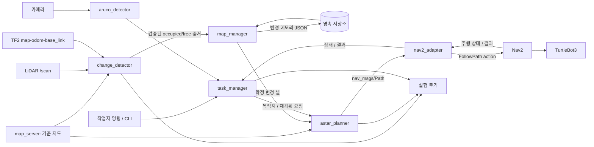
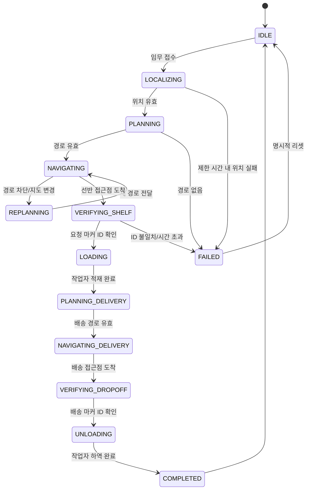

# SMART-VISION / RESILIENT-AMR 통합 시스템 설계안

작성일: 2026-10-20
상태: 팀 검토용 설계 초안
기준: 제안서 수정-1, 현재 `resilient-amr-astar` Python 격자 프로토타입

## 1. 설계 목표와 구현 경계

이 시스템은 TurtleBot3가 ArUco로 위치 기준과 선반을 확인하고, 물류 임무를 수행하며, LiDAR로 발견한 지속적인 환경 변화를 기준 지도와 분리해 기록하고 다음 임무 및 재시작 뒤 전역 경로에 반영하는 ROS 2 AMR 프로토타입이다.

핵심 연구 대상은 반복 관측으로 검증한 환경 변화의 저장·복원·재사용 정책이다. Nav2의 충돌 감지와 로컬 안전 동작은 항상 활성화한다. 변화 검증을 기다리느라 장애물 대응을 늦추지 않는다.

기존 Python A*와 메모리 모듈은 ROS와 독립된 경로 계산·기억 엔진으로 유지한다. 실제 로봇 통합에는 ROS 2 어댑터, 지도 좌표 변환, LiDAR 가시성 기반 관측, 임무 관리, ArUco 인식, Nav2 실행 인터페이스가 추가된다. 이 문서는 구현 계약을 정하며, 학원 장비에서 확인되지 않은 토픽 이름·모델·맵 경로는 파라미터로 둔다.

## 2. 시스템 구성



### 실행 책임

| 노드/구성요소 | 책임 | ROS 통신 방향 |
| --- | --- | --- |
| `task_manager` | 임무 FSM, 선반 목적지 조회, 이동·적재·배송 상태 전이, 실패 처리 | CLI/서비스 입력, nav2_adapter 상태, ArUco 결과, 작업 상태 토픽 |
| `aruco_detector` | 카메라 이미지에서 마커 ID와 카메라 기준 pose 산출 | 이미지 구독, 검출 결과 토픽 발행 |
| `localization_manager` | 기준 마커의 등록 pose와 TF 변환으로 초기 pose 산출/AMCL 초기화 요청 | ArUco/TF 구독, `/initialpose` 발행 |
| `change_detector` | 기준 OccupancyGrid와 scan/TF를 비교하고 실제 관측된 셀만 증거로 제출 | `/map`, `/scan`, TF 구독, 관측 이벤트 발행 |
| `map_manager` | 증거 누적·확정·해제, 맵 식별 검사, 원자적 저장·복구 | 이벤트 구독, 메모리 상태 발행, 저장/복구 서비스 |
| `astar_planner` | 기준 지도와 확정 메모리의 합집합으로 전역 경로 계산 | 계획 요청 입력, `nav_msgs/Path` 발행 |
| `nav2_adapter` (`path_follower`) | 계획 경로를 컨트롤러에 전달하고 이전 경로를 정리한 뒤 최신 경로만 실행, 취소·완료 결과 연결 | Nav2 `FollowPath` action |
| `experiment_logger` | 설정/조건별 재계획, 전환, 변화 반영 시간, 주행 거리, 완료 결과 기록 | 주요 상태 토픽 구독, CSV/JSONL 기록 |

`task_manager`, `change_detector`, `map_manager`, `astar_planner`는 연구 기능 노드다. Nav2는 로봇의 제어·로컬 costmap·충돌 안전 기능을 담당한다. 경로계획 기능을 중복 실행하지 않도록 주행 구성은 다음 중 하나로 확정한다.

**권장 초기 통합:** 자체 A*가 전역 `Path`를 만들고 Nav2 `FollowPath`가 추종한다. 이 구성은 사용자가 구현한 A*가 실제 호출됐는지 확인하기 쉽다. Nav2의 기본 global planner를 동시에 임무 계획기로 사용하지 않는다. 실험 기준 A/B에서도 동일 A* 및 Nav2 controller를 사용하고 메모리 정책만 바꾼다. A* 경로의 footprint/inflation 처리와 controller가 수용하는 경로 형식은 Gazebo 기준선 시험에서 검증한다.

## 3. 기준 프레임과 지도 좌표 계약

- 전역 프레임은 `map`, 로봇 기준 프레임은 실제 TurtleBot3 설정의 `base_link`/`base_footprint`로 통일한다.
- 좌표 길이 단위는 m, 각도는 rad, 시각은 ROS clock 기준으로 기록한다. 시뮬레이션에서는 `/clock` 및 `use_sim_time=true`를 일관되게 사용한다.
- `OccupancyGrid`의 셀 좌표는 원점 pose와 회전, 해상도를 반영해 `map` 좌표와 왕복 변환한다. 행/열 방향을 테스트하고, Y축 반전이나 맵 원점 오프셋을 눈으로만 추정하지 않는다.
- 메모리는 배열 인덱스만 저장하지 않고 `map_id`, 해시/버전, frame, width, height, resolution, origin pose를 함께 기록한다. 지문이 다르면 자동 적용을 거부하고 명시적 재매핑 절차를 요구한다.
- ROS OccupancyGrid의 미지(unknown)는 자유 공간으로 간주하지 않는다. A*는 미지 셀 통과 여부를 파라미터화하되 기본값은 통과 금지로 둔다.

## 4. 환경 변화 감지와 검증

### 4.1 관측 생성

1. `LaserScan`을 TF2로 각 광선을 `map` 프레임에 투영한다.
2. 광선 시작점부터 유효 반환점 직전까지는 관측된 free 후보, 유효 반환 끝점은 occupied 후보로 만든다. `range_min`, `range_max`, NaN/inf 및 센서 가림/자기 반사 규칙을 적용한다.
3. 맵 셀과 비교한다. 기준 지도의 occupied 셀은 이미 알려진 장애물이며 새 변화로 중복 기록하지 않는다. 기준 지도의 free 셀에서 생긴 occupied 관측은 추가 장애물 후보가 된다.
4. 장애물 제거 후보는 과거 변경 occupied 셀에 대해 광선이 실제 통과한 free 관측만 인정한다. 단순히 scan에 점이 없거나 셀이 가려져 있는 상태는 free 증거가 아니다.
5. 한 scan 안에서 같은 셀에 반복 생성된 광선 표본을 무한히 누적하지 않도록 scan/시간 bucket별 증거를 제한한다.

### 4.2 검증 정책

`change_detector`는 원시 점유/자유 증거와 관측 시각, scan 식별자를 전달한다. `map_manager`는 셀별 다음 정보를 유지한다.

- 상태: `candidate_occupied`, `confirmed_occupied`, `candidate_free`
- 점유/자유 관측 수, 첫 관측 시각, 마지막 관측 시각, 연속 증거 시각
- 지도 지문 및 셀 좌표
- 선택 사항: confidence, 센서 관측 방향/품질 요약

확정은 최소 관측 수와 최소 지속 시간 모두 충족했을 때 수행한다. 관측 횟수만으로 지속성을 결정하지 않는다. 제거는 변경 셀이 충분히 가시화된 상태에서 서로 다른 시각 구간의 free 근거가 기준을 충족할 때만 수행한다. 임계값은 YAML 파라미터로 설정하고 실험마다 로그에 기록한다. 초기 수치는 시뮬레이션에서 조정할 값이며 제안서의 확정 연구 결과로 표현하지 않는다.

### 4.3 안전과 재계획

- Nav2 local costmap와 controller의 즉각 정지/회피는 기억 확정과 무관하게 작동한다.
- 새 occupied 후보는 현재 임무 경로를 막는지 확인한다. 안전 정지는 Nav2에 맡기고, 확정 전 임시 차단 셀을 A* 재계획에 반영할지 여부는 별도 파라미터/실험 조건으로 둔다.
- 메모리 확정·해제 이벤트, 임무 목표 변경, 실행 중 경로 차단을 재계획 원인으로 기록한다.
- 재계획 중 이전 FollowPath goal을 취소하고 새 경로 검증 후 전달한다. 실패·취소·stale map 시 무한 재시도하지 않고 task FSM을 안전 정지/실패 상태로 전환한다.

## 5. 물류 임무 FSM



임무 데이터는 `task_id`, source shelf ID, 물품 코드/수량, dropoff ID, 상태, 생성 시각을 포함한다. 선반 ID는 사전 등록된 접근 pose에 매핑한다. 카메라 마커는 도착 확인용이며 목적지 좌표 그 자체로 쓰지 않는다. 물품 개별 객체 검출(YOLO)은 범위에서 제외하고 작업자가 적재/하역 완료를 확인한다.

## 6. ROS 인터페이스 초안

실제 TurtleBot3 launch가 사용하는 토픽·액션 이름을 먼저 확인한 뒤 remapping한다. 아래는 논리 인터페이스다.

| 인터페이스 | 타입/형태 | 방향 및 목적 |
| --- | --- | --- |
| 기준 지도 | `nav_msgs/msg/OccupancyGrid` | map_server → detector/planner |
| LiDAR | `sensor_msgs/msg/LaserScan` | 로봇 → detector |
| TF | TF2 | localization/robot_state → detector/planner/task |
| 카메라 | `sensor_msgs/msg/Image` + `CameraInfo` | 로봇 → ArUco detector |
| 초기 위치 | `geometry_msgs/msg/PoseWithCovarianceStamped` | localization_manager → AMCL |
| 변경 증거 | 우선 내부 ROS 메시지 `CellObservation` 정의 권장 | detector → map_manager; cell, evidence, stamp, scan sequence, map_id |
| 변경 상태 | 내부 ROS 메시지 `MapChange` 또는 `OccupancyGrid` overlay | map_manager → planner/RViz/logger |
| 계획 경로 | `nav_msgs/msg/Path` | planner → task/nav2 adapter |
| 주행 | `nav2_msgs/action/FollowPath` | adapter → Nav2 controller |
| 새 임무 | 내부 `SubmitTask` 서비스 또는 간단 CLI | operator → task_manager |
| 선반 DB | 정적 YAML + 조회 함수 | task_manager에서 ID→접근 pose/marker ID 매핑 |
| 저장/복원 | `SaveMemory`, `ReloadMemory` 서비스 | 운영자/launch → map_manager |
| 상태 | `diagnostic_msgs` 또는 내부 status 토픽 | 노드 → RViz/logger/운영자 |

먼저 커스텀 메시지 없이 `OccupancyGrid`, `Path`, 표준 action과 YAML을 사용해 수직 기능을 연결할 수 있다. 증거 이벤트의 시각/scan 중복 제한을 표준 메시지로 표현하기 어렵다면 `resilient_amr_interfaces` 패키지에 최소 메시지·서비스를 추가한다.

## 7. 메모리 파일과 복구 동작

기준 지도 파일은 수정하지 않는다. 변경 기억은 별도 JSON 또는 occupancy overlay 파일로 저장한다. 기록은 임시 파일에 쓰고 flush/fsync 뒤 원자적 rename을 적용한다. 파일에는 schema version, map fingerprint, 검증 임계값, 셀 상태/증거, 마지막 갱신 시각을 기록한다.

시작 절차:

1. map_server의 기준 지도를 수신한다.
2. map fingerprint를 계산한다.
3. 기억 파일이 없으면 빈 기억으로 시작하고 로그에 기록한다.
4. 기억 파일 형식과 map fingerprint가 정확히 맞으면 불러온다.
5. 형식 손상/다른 지도/미지원 버전이면 자동으로 좌표 적용하지 않는다. 명확한 진단을 내고 메모리 비활성 상태 또는 운영자 승인 복구로 전환한다.
6. planner가 준비 상태를 알린 뒤에만 임무를 받는다.

장애물 해제 또는 새 확정은 메모리 파일에 즉시 원자적으로 반영한다. 파일 쓰기 실패가 주행 안전을 훼손하지 않도록 현재 세션 메모리는 유지하되 저장 실패 상태를 알리고 실험 성공 로그와 구분한다.

## 8. A/B 실험 설계와 계측

두 조건은 동일한 기준 지도, 시작/목표, A*, footprint, Nav2 controller, 속도/안전 설정을 사용한다.

| 조건 | 계획 시 추가 persistent memory | 메모리 확정/재사용 |
| --- | --- | --- |
| A 기준선 | 없음. 순간 장애물은 Nav2 안전 기능이 처리 | 비활성 |
| B 제안 방식 | 검증된 변경 overlay | 활성 |

두 조건의 안전 정지·로컬 회피는 동일하게 켠다. 기준선에도 동일 planner 재계획 트리거를 적용하여 구현 차이가 아니라 정책 차이를 비교한다. 시나리오는 transient obstacle, persistent obstacle, restart-after-confirmation, obstacle removal로 분리한다. 조건별 반복 횟수와 실행 순서는 고정/기록하고, 장애물 시각과 위치는 동일하게 재현한다.

최소 계측 이벤트는 timestamp, run_id, condition, task_id, map fingerprint, event, cause, pose, path hash/길이, memory cell count, action status를 포함한다. 주요 지표:

- 임무당 계획 호출 수와 경로 변경 수(두 지표를 분리)
- 장애물 설치/제거부터 확정·해제까지의 시간
- 주행 거리, 완료 시간, 성공률
- 지속/제거 판정 정확도와 오탐·미탐
- 재시작 직후 재관측 전 계획이 기억 장애물을 반영했는지

연구 가설은 결과가 나오기 전에는 기대 효과로만 기술한다. 성공 기준과 판정 통계는 팀이 실험 횟수·환경을 확정하면서 정한다.

## 9. 설정 파일 초안

설정은 launch 인자와 YAML로 분리한다. 민감한 값은 없다.

```yaml
frames:
  global: map
  robot_base: base_link
topics:
  map: /map
  scan: /scan
  image: /camera/image_raw
memory:
  path: ~/.ros/resilient_amr/environment_memory.json
  confirm_observations: 5
  confirm_min_duration_sec: 2.0
  clear_observations: 5
  clear_min_duration_sec: 2.0
  distinct_observation_bucket_sec: 0.25
planner:
  allow_unknown: false
  obstacle_inflation_cells: 1
aruco:
  dictionary: DICT_4X4_50
  marker_size_m: 0.10
  reference_markers: {}
  shelves: {}
tasks:
  dropoff_id: 4
```

위 threshold와 marker 크기는 예시 파라미터이며 실제 센서/맵/실험에서 측정·조정한다. 맵·로봇 모델·액션 이름은 실행 전에 학원 환경에서 확인한다.

## 10. 저장소 구성 목표

```text
resilient-amr-astar/
  docs/SYSTEM_DESIGN.md
  src/resilient_amr/                 # ROS 독립 A*, map grid, memory, observation logic
  ros2_ws/src/
    resilient_amr_interfaces/        # 필요 시 최소 custom msg/srv
    resilient_amr_bringup/           # launch, params, shelf/marker config
    resilient_amr_nodes/             # task, detector, map manager, planner, logger 노드
  tests/                              # 순수 알고리즘 단위 검증
  README.md                           # 설치/실행/실험 절차
```

기존 저장소는 순수 Python 프로젝트다. ROS 2 패키지로 전환할 때 ROS 환경 의존성을 코어 알고리즘에 섞지 않고 `ros2_ws` 어댑터 계층에 둔다. ROS 2 Humble Python 패키지 빌드, custom interfaces 사용 여부, Nav2 액션/launch는 학원 PC에서 실제 배포판에 맞춰 결정한다.

## 11. 단계별 구현 및 완료 조건

| 단계 | 결과물 | 완료 조건 |
| --- | --- | --- |
| 0. 환경 기준선 | TurtleBot3 모델, ROS 배포판, 월드/맵, topic/action 목록 | 실제 Nav2 주행과 map/scan/TF 확인 |
| 1. 설계 계약 | 인터페이스·frame·저장 스키마·실험 조건 확정 | 팀원이 동일 데이터 흐름을 설명할 수 있고 중복 planner가 없음 |
| 2. 코어 강화 | OccupancyGrid 좌표 변환, 시각 기반 memory, 파일 fingerprint | 오프라인 fixture에서 변환·저장·복구 조건 명확 |
| 3. 변화 검출 | scan ray visibility와 기준 지도 비교 | 가림 셀을 free 처리하지 않고 재현 시나리오 통과 |
| 4. 계획 주행 | A* 경로 → Nav2 FollowPath, 취소/재계획 | 로그로 자체 A* 경로가 추종됐음을 입증 |
| 5. 물류 작업 | ArUco 기준 초기화, 선반 ID 검증, task FSM | 잘못된 마커는 완료로 처리하지 않음 |
| 6. 기억 재사용 | 저장/재시작/제거·복원 실험 | 장애물 재관측 전에 기억으로 전역 경로 변경 확인 |
| 7. 비교 평가 | A/B 조건과 run 로그, 결과 표/그래프 | 반복 실험 원자료와 실패 기록 보존 |

3주 일정 안에 통합이 어려우면 우선순위는 ① 기준선과 persistent memory 재사용, ② 안전한 변화 검증·재계획, ③ ArUco 위치 초기화, ④ 선반 물류 FSM의 순서로 둔다. 이는 범위 축소 결정이 아니라 일정 위험을 드러내기 위한 우선순위 제안이다.

## 12. 현재 코드와의 대응

| 설계 요소 | 현재 상태 | 다음 구현 |
| --- | --- | --- |
| 8방향 A*, 코너 절단 방지 | `src/resilient_amr/astar.py` 구현 | ROS map 변환, 미지 셀/footprint/inflation 정책 |
| 점유/빈 공간 누적과 JSON | `obstacle_memory.py` 구현 | VM에서 가시성/시간 threshold 검증 |
| ASCII grid | `grid.py` 구현 | OccupancyGrid 변환 어댑터 추가 |
| ROS 노드와 Nav2 action | ROS 패키지 추가, VM 검증 전 | colcon build, topic/action 및 FollowPath 통합 확인 |
| LiDAR 가시성 추론 | ray projection/evidence 코드 추가, VM 검증 전 | TF/time alignment, scan/map 오검출 조정 |
| ArUco/Task FSM | ID 검출, 설정 기준 위치 초기화, 임무 FSM 코드 추가 | Gazebo tag placement, 카메라/TF/접근 pose 설정 및 검증 |
| 성능 로그/A-B 실험 | JSONL event logger 및 memory on/off 조건 추가 | 반복 실험, event 분석 및 지표 집계 |

### ROS 2 bringup 구현 상태 (2026-10-20)

이 설계서를 작성한 뒤 Ubuntu VM 실행을 위해 ROS 2 Humble용 ament_python 패키지를 추가했다. 현재 코드는 이 문서의 설계 전체가 VM에서 검증됐다는 의미가 아니다.

- ros2_ws/src/resilient_amr_bringup/launch/sim.launch.py: TurtleBot3 world, Nav2, 코어 ROS 노드 launch
- change_memory: LiDAR ray visibility, 시간·횟수 기준 변화 검증, map fingerprint 검사, 영속 JSON
- astar_planner + path_follower: OccupancyGrid/변경 셀 A* 계획 및 Nav2 FollowPath 전달
- task_manager: 선반/배송 임무 FSM, 마커 확인, 작업자 적재·하역 확인
- aruco_detector: marker ID 인식 및 설정된 reference marker pose에서 AMCL initial pose 계산
- experiment_logger: A/B 조건과 path/memory/task/navigation 이벤트 JSONL 기록

현재 제한: VM에서 colcon build 및 Gazebo 실행을 아직 검증하지 않았다. 기본 world에 ArUco 표식이 있다고 가정하지 않으며, reference marker pose 및 shelf/dropoff 접근 좌표, 카메라 토픽/TF는 사용 환경에 맞춰 입력해야 한다. A* 경로 footprint와 Nav2 추종 품질도 Gazebo에서 확인한다.

## 13. 팀에서 확정할 결정

1. 학원 환경의 정확한 ROS 2/Nav2 버전, TurtleBot3 모델, 센서 토픽, 월드/기준 지도.
2. A* 경로를 Nav2 `FollowPath`로 추종하는 권장 방식의 수용 여부.
3. 기준 마커와 선반 마커의 ID, pose, 크기, 접근 pose 및 카메라 보정값.
4. 메모리 확정·제거 threshold와 scan bucket, 임시 장애물을 전역 계획에 반영할 시점.
5. 장애물 inflation 및 footprint를 어느 계층에서 적용해 A*와 Nav2 controller가 일치하도록 할지.
6. 실험 반복 수, 정량 성공 기준, logger 저장 형식.
7. 팀별 노드 ownership, ROS 인터페이스 담당자, 통합 브랜치/실행 방법.
